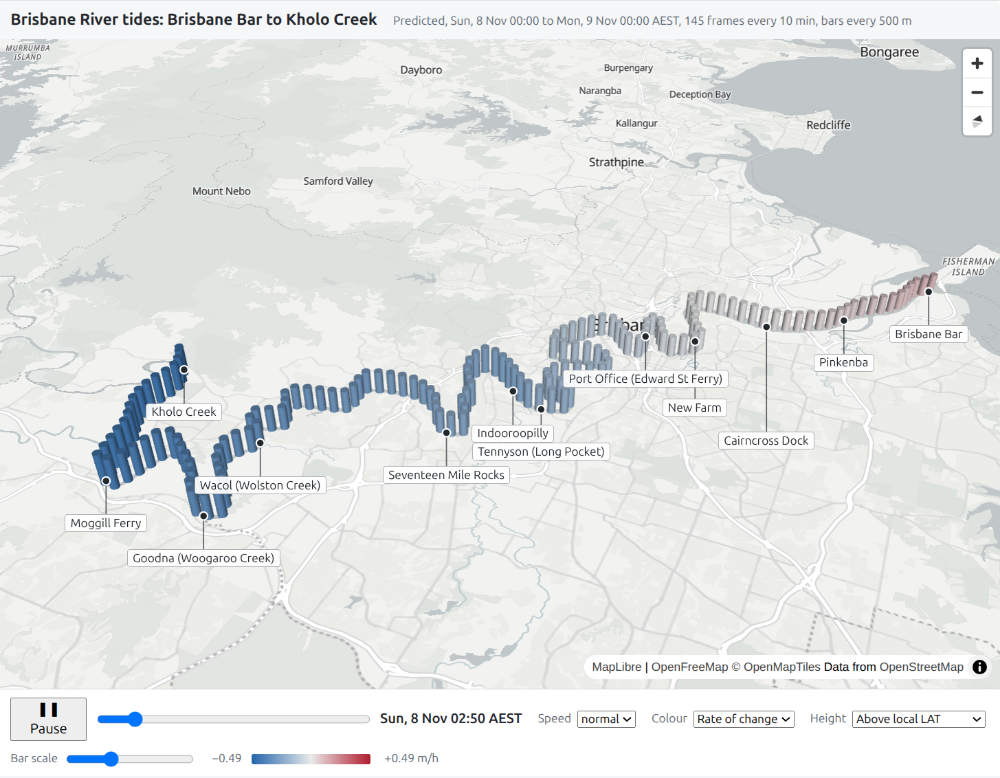

# Brisbane River tides

An interactive page that shows the **predicted tide** along the Brisbane River, from the Brisbane Bar to Kholo Creek, for any day in 2026 and 2027. It's a personal hobby project, made by a kayaker who wanted to see when the tide turns along different reaches of the river.

**Open the page: <https://rowanp4069.github.io/Brisbane-River-tides/>** It opens on today in Brisbane. Pick another day with the ◀ ▶ buttons or the calendar, and share a day with a link such as `…/Brisbane-River-tides/#2026-12-25`.

> **Predicted astronomical tide only. Not for navigation.**
> The model leaves out river flow, rain and dam releases, wind and storm surge. After rain the ebb can run for hours longer than shown, and the flood can disappear upriver altogether. The colours are proxies for flow direction worked out from predicted water level. They are not measured or modelled currents. Use Maritime Safety Queensland's official tide tables and local knowledge for planning.

## What it shows

- **3D map:** a bar every 500 m along the river. Bar height is the predicted water level, and the colour shows whether it's rising or falling (or the rate of change, or a surface-slope proxy).
- **Profile:** the same data along the river as a chart. A shaded band shows the range at each point over the whole 24 h or 48 h window: its top line (solid) is the highest level there, its bottom line (dashed) the lowest. Each point reaches its highest at a different time (the tide arrives later upstream), so the top line is not the river at any one moment.
- **Marked place:** tap or drag on the profile, click a bar on the map, or pick a tide station or boat ramp from the **Place** list. The place gets a purple line on the profile and a purple ring and label on the map, and a readout of its height now, whether it's rising or falling, and its highest and lowest in the window with their times. It snaps to the nearest 500 m point, and goes in the address too (e.g. `…/#2026-12-25/km2.5`) so a link opens on the same day and place.
- **Day:** ◀ ▶ for the previous or next day, a date box with a calendar, **Today**, and a 24 h or 48 h window. Changing day keeps the same time of day, and the day goes in the address so a link opens on it.
- **Time controls:** 10-minute steps through the window, with play/pause, speed, and arrow keys to step through it. **Now** jumps to the current time in Brisbane and pauses there; **−1 h** and **+1 h** step an hour at a time, carrying on into the next or previous day.

## How it works

Only the Brisbane Bar has a published 10-minute prediction. Upriver places are published as corrections relative to the Bar: a time lag and a height ratio (Maritime Safety Queensland's *Semidiurnal Tidal Planes*). For each point along the river, the script takes the Bar prediction, delays it by that point's lag, scales it by its ratio, and adds the local mean sea level:

    height(x, t) = MSL(x) + ratio(x) × (Bar(t − lag(x)) − MSL_Bar)

Lag, ratio and MSL are interpolated along the river between the published places. Distances are measured along the river centreline, built from Queensland watercourse data.

## Run it

Needs Python 3 (developed on 3.14). From the project folder:

    python3 -m venv .venv
    .venv/bin/pip install -r requirements.txt
    .venv/bin/python river_tides.py --start 2026-11-08

You only need this to make a page for other dates or settings; the hosted page above is built the same way. This writes `output/index.html` (the predictions page), which can show any day the Bar data covers. `.venv/bin/python build_gauges.py` writes `output/gauges.html` next to it. Open it in a web browser. The page needs an internet connection for the map libraries and tiles, and the 3D map needs WebGL (without it, the profile and controls still work).

Useful options (`--help` lists them all):

- `--start 2026-11-08T06:00`: the day the page opens on, and the time of day each window starts (local AEST). Without it, the page opens on the viewer's today.
- `--hours 12`: window length (default 48). The page offers 24 h and 48 h, plus this if different.
- `--csv FILE ...`: different Brisbane Bar prediction file(s). By default it uses every `data/bar_YYYY_10min.csv`; 2026 and 2027 are committed. `fetch_bar.py --year YYYY` fetches another year.
- `--json FILE`: also save the page data as JSON.
- `--stamp`: show when the page was built (AEST). The hosted page uses it; it's off by default so repeat runs give identical files.
- `--sandbox`: build the Guesswork page (`output/guesswork.html`) instead; see below.

The page computes each day's heights itself, with the same formula as `river_tides.py`. Python works out everything about places (the points, and each one's lag, ratio and MSL). `check_parity.py` checks that the page and Python agree to within the 1 mm rounding, over a set of test days; run it after changing the model on either side (it needs Node.js). It also checks that the Measured vs predicted page's statistics match `compare_gauges.py`.

`build_centreline.py` rebuilds `data/centreline.csv` from the saved watercourse data. You only need it if that data or the station positions change.

## Gauges page (measured)

A second page, **Gauges**, shows what the river actually did: the last 24, 48 or 72 hours of readings from Brisbane City Council's eight Brisbane River gauges, from Breakfast Creek to Moggill, and the Bureau of Meteorology's Colleges Crossing gauge (540063, km 83.8, above Kholo Creek). <https://rowanp4069.github.io/Brisbane-River-tides/gauges.html>

- The page fetches the readings **live** from the council's open data service when it opens (⟳ Refresh fetches again). Nothing is forecast.
- Heights are **metres AHD**, one datum for every gauge, so unlike the predictions they form a real water surface. The predictions use each place's LAT, about 1.2 m lower at Port Office.
- Readings arrive at irregular times. Gaps of up to an hour are bridged with a straight line; longer gaps, and gauges whose latest readings haven't arrived yet, show as *no reading*.
- **Colleges Crossing** comes from the project's own copy of BoM's readings on the gauge-data branch (`bom/`, collected every 15 minutes, and `bom-filled/`, filled by hand from BoM's table), so it can lag a little; the page says when its latest reading is over an hour old. It reports only each 0.05 m change, so its last level is held for up to 3 hours. It reads nothing below 0.59 m AHD, shown as *at gauge floor* (0.59 m or lower). One-off telemetry glitches are left out, by the same rule as `compare_gauges.py`.
- `build_gauges.py` builds it (`output/gauges.html`). `data/gauges.csv` holds each gauge's position along the river; `build_gauges.py --download` remakes it from the council's gauge list.

The two pages link to each other at the top. Locally, `river_tides.py` writes `output/index.html` (predictions), named as on the website so the links work.

## Measured water levels (archive)

`collect_gauges.py` saves measured river levels each day, before the sources drop them: eight Brisbane City Council gauges (Breakfast Creek to Moggill), the MSQ Brisbane Bar gauge, and 11 Queensland Government storm tide gauges around Moreton Bay, Pumicestone Passage and the Broadwater (with their official predictions, for the future Moreton Bay work). A scheduled GitHub Action runs it and stores the readings on the [`gauge-data` branch](https://github.com/RowanP4069/Brisbane-River-tides/tree/gauge-data). They aren't used by the page yet; they're for comparing the predictions against what the river actually did. `docs/data-sources.md` describes the sources.

`compare_gauges.py` compares those readings with the predictions: run `git fetch origin gauge-data`, then `python compare_gauges.py` (optionally `--since` / `--until`). For each gauge it reports the datum offset (council gauges read AHD, the model LAT), how far the measured level strays from the prediction, and how early or late each high and low water came, with high and low water reported separately. It builds the **Measured vs predicted** page (<https://rowanp4069.github.io/Brisbane-River-tides/compare.html>; `output/compare.html` locally), where you can pick any period we have readings for; the fitting is done once in Python and the page only averages over the period you choose. The website rebuilds it whenever the daily collection finishes. The script's description lists the method's known limits. Two things the council data does: a gauge only reports when the level moves a step (1 to 5 cm), and the Jindalee and Moggill gauges seem unable to read low water.

Colleges Crossing (BoM gauge 540063, km 83.8) is on the page too, above Kholo Creek where there are no predictions, so it is compared with the Guesswork page's guesses and labelled as such: its timing tests G-lag, and its fitted "LAT below AHD" sits beside G-datum. Its readings come from BoM's web table for the gauge (gauge-data `bom-filled/`, from 1 Nov 2026) and the 15-minute FTP collection (`bom/`). BoM's series has one-off telemetry glitches (a single reading 0.40 or 0.80 m out, often in the same minute as a real one); `compare_gauges.py` drops those, but not freshwater after rain, which raises the whole level for hours or days and shows in the residuals.

## Report the flow (citizen science)

A fourth page, **Report the flow**, lets people on the river report which way the water was moving, how strongly, and how the water looked: <https://rowanp4069.github.io/Brisbane-River-tides/report.html>. Reports are taken from the mouth up to the old weir ruin below Mt Crosby (km 87.4), where the tide stops. When a report is sent below Kholo Creek, the page compares it with the model at that place and time (rising level: water coming in; falling: going out; within 45 minutes of high or low water: turning) and says whether it matches. A mismatch is useful data: the current turns later than the level, and freshwater flow pushes it downstream.

- `build_report.py` builds the page. Reports go to a Google Form owned by the project. Its sheet publishes only the time and the public part of each report: the place as km up the river and which bank, never the exact position, and not the notes.
- `collect_reports.py` checks the published reports once a day (time, place, values; exact repeats dropped) and rewrites the [`reports` branch](https://github.com/RowanP4069/Brisbane-River-tides/tree/reports), whose README describes the columns. The page's map and list show the last 30 days.
- The map shows public boat ramps (`data/ramps.csv`, from Brisbane City Council and MSQ's Beacon to Beacon guide) as places to find; tapping one sets the report's place.
- Above Kholo Creek, where the tide tables stop, reports are recorded without a verdict.
- The page remembers the reporter's name in the browser (local storage, not a cookie) and gives each device a random ID. Reports publish its first 8 characters as `device`, so reports from one device can be grouped; the private part keeps the whole ID. Nothing about the person or their IP address is stored.
- To hide a report, add its `submitted_aest` to `data/reports_hidden.csv`; to hide every report from a device, fill in the `device` column instead. They disappear at the next daily run.
- Reports are shared under CC BY 4.0.

### Results

**Report the flow (results)** gathers everything seen so far: every accepted report and the project's own field observations (`data/observations.csv`), on a map with two confidence lines (Indooroopilly, where MSQ's published ratios end, and Kholo Creek, where MSQ's figures end), a summary by reach, and a chart of where along the river and how long before or after high water at the Bar each was seen: <https://rowanp4069.github.io/Brisbane-River-tides/results.html>.

- `build_results.py` builds it, working each report's verdict out again against the current model, so the match rate follows the model as it improves. The build prints any report whose verdict differs from the one the reporter was shown.
- A reach's match rate shows as "m of n" until it has 5 checkable reports, then as a percentage. Reports from one device are counted as one device, so a single keen paddler doesn't look like many confirmations.
- Above Kholo Creek the page shows the hypotheses under test (`docs/hypotheses.md`) with their running tallies.
- [docs/report-form-setup.md](docs/report-form-setup.md) says how the Google Form and its sheet are set up, to check or rebuild them.

## Guesswork: Kholo Creek to the weir ruin

A **sandbox**, not predictions (the "Guesses" link on every page): <https://rowanp4069.github.io/Brisbane-River-tides/guesswork.html> (kept out of search engines). It is the predictions page with the same model to Kholo Creek, carried on to the old weir ruin (km 87.4) with **guesses**, each named and dated in `data/guesses.csv`: G-lag and G-ratio (held at Kholo Creek's values), G-datum (Kholo Creek's LAT in m AHD, so heights can be read against the gauge and level marks) and G-floor (the crests of the gravel runs: above a run the water can't fall below its crest, and the bar shows it "running fresh"). Guess bars are pale and hatched; the project's own field observations are dark markers, with a list under the profile.

- `river_tides.py --sandbox` builds it; the hosted site builds it with the other pages.
- Under the profile, a **tidal-head chart** shows everything seen above km 75 (flow reports and our observations) against the predicted Kholo Creek level at the time, with the gravel runs as lines and the guessed crests as ticks. It contains no guesses itself: it is the evidence the G-floor guesses can be checked against.
- A guess tuned on a day's data can't count as a test on that day (`not_a_test_on`). Changing a guess means a new date on its row; git keeps the old value.
- Guesses are not hypotheses. Claims tested against data set in advance stay in `docs/hypotheses.md`, and only they can ever reach the Predictions page.

## Limitations

The main ones are below. `data/README.md` covers them in full, along with the data sources and how each file was made.

- Heights at each place are above that place's own lowest astronomical tide (LAT), so they can't be compared as one water surface.
- One lag and one ratio per place. The real tide upriver has a shorter, steeper flood and a longer ebb, which this method can't reproduce.
- From Seventeen Mile Rocks upstream there are no published ratios, so the model uses an estimate. On big spring tides, heights there can dip below LAT.
- Between Indooroopilly and Seventeen Mile Rocks the published low-water lag decreases going upstream, so the tide appears to arrive earlier further up. This is in the published tables (the same in 2025 and 2026), and the page marks it.

## Data and attribution

All source data is © State of Queensland and licensed under [CC BY 4.0](https://creativecommons.org/licenses/by/4.0/):

- Brisbane Bar predicted tides and the Semidiurnal Tidal Planes: Maritime Safety Queensland (Department of Transport and Main Roads).
- Watercourse lines – Queensland: Department of Resources.

Basemap: [OpenFreeMap](https://openfreemap.org), © OpenMapTiles, data from OpenStreetMap. The map shows this attribution itself.

## Acknowledgements

Built with help from Claude (Anthropic), using Claude Code.

## Licence

The code (`river_tides.py`, `build_centreline.py`, `collect_gauges.py`, `fetch_bar.py`, `check_parity.py`, `build_gauges.py`, `compare_gauges.py`, `build_report.py`, `collect_reports.py` and `web/`) is under the MIT licence; see [LICENSE](LICENSE). The files in `data/` keep their original CC BY 4.0 licences, as listed above.
