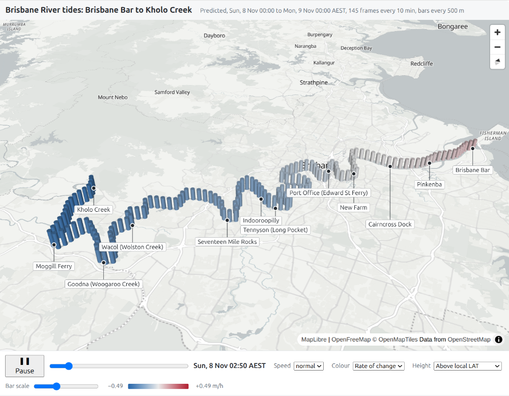

# Brisbane River tides

An interactive page that shows the **predicted tide** along the Brisbane River, from the Brisbane Bar to Kholo Creek, for any day in 2026 and 2027. It's a personal hobby project, made by a kayaker who wanted to see when the tide turns along different reaches of the river.

**Open the page: <https://rowanp4069.github.io/Brisbane-River-tides/>** It opens on today in Brisbane. Pick another day with the ◀ ▶ buttons or the calendar, and share a day with a link such as `…/Brisbane-River-tides/#2026-12-25`.

> **Predicted astronomical tide only. Not for navigation.**
> The model leaves out river flow, rain and dam releases, wind and storm surge. After rain the ebb can run for hours longer than shown, and the flood can disappear upriver altogether. The colours are proxies for flow direction worked out from predicted water level. They are not measured or modelled currents. Use Maritime Safety Queensland's official tide tables and local knowledge for planning.

## What it shows

- **3D map:** a bar every 500 m along the river. Bar height is the predicted water level, and the colour shows whether it's rising or falling (or the rate of change, or a surface-slope proxy).
- **Profile:** the same data along the river as a chart, with the day's high-to-low range at each point.
- **Day:** ◀ ▶ for the previous or next day, a date box with a calendar, **Today**, and a 24 h or 48 h window. Changing day keeps the same time of day, and the day goes in the address so a link opens on it.
- **Time controls:** 10-minute steps through the window, with play/pause, speed, and arrow keys to step through it.

## How it works

Only the Brisbane Bar has a published 10-minute prediction. Upriver places are published as corrections relative to the Bar: a time lag and a height ratio (Maritime Safety Queensland's *Semidiurnal Tidal Planes*). For each point along the river, the script takes the Bar prediction, delays it by that point's lag, scales it by its ratio, and adds the local mean sea level:

    height(x, t) = MSL(x) + ratio(x) × (Bar(t − lag(x)) − MSL_Bar)

Lag, ratio and MSL are interpolated along the river between the published places. Distances are measured along the river centreline, built from Queensland watercourse data.

## Run it

Needs Python 3 (developed on 3.14). From the project folder:

    python3 -m venv .venv
    .venv/bin/pip install -r requirements.txt
    .venv/bin/python river_tides.py --start 2026-11-08

You only need this to make a page for other dates or settings; the hosted page above is built the same way. This writes `output/index.html` (the predictions page), which can show any day the Bar data covers. `.venv/bin/python build_gauges.py` writes `output/gauges.html` next to it. Open it in a web browser. The page needs an internet connection for the map libraries and tiles, and the 3D map needs WebGL (without it, the profile and controls still work).

Useful options (`--help` lists them all):

- `--start 2026-11-08T06:00`: the day the page opens on, and the time of day each window starts (local AEST). Without it, the page opens on the viewer's today.
- `--hours 12`: window length (default 48). The page offers 24 h and 48 h, plus this if different.
- `--csv FILE ...`: different Brisbane Bar prediction file(s). By default it uses every `data/bar_YYYY_10min.csv`; 2026 and 2027 are committed. `fetch_bar.py --year YYYY` fetches another year.
- `--json FILE`: also save the page data as JSON.
- `--stamp`: show when the page was built (AEST). The hosted page uses it; it's off by default so repeat runs give identical files.

The page computes each day's heights itself, with the same formula as `river_tides.py`. Python works out everything about places (the points, and each one's lag, ratio and MSL). `check_parity.py` checks that the page and Python agree to within the 1 mm rounding, over a set of test days; run it after changing the model on either side (it needs Node.js).

`build_centreline.py` rebuilds `data/centreline.csv` from the saved watercourse data. You only need it if that data or the station positions change.

## Gauges page (measured)

A second page, **Gauges**, shows what the river actually did: the last 24, 48 or 72 hours of readings from Brisbane City Council's eight Brisbane River gauges, from Breakfast Creek to Moggill. <https://rowanp4069.github.io/Brisbane-River-tides/gauges.html>

- The page fetches the readings **live** from the council's open data service when it opens (⟳ Refresh fetches again). Nothing is forecast.
- Heights are **metres AHD**, one datum for every gauge, so unlike the predictions they form a real water surface. The predictions use each place's LAT, about 1.2 m lower at Port Office.
- Readings arrive at irregular times. Gaps of up to an hour are bridged with a straight line; longer gaps, and gauges whose latest readings haven't arrived yet, show as *no reading*.
- `build_gauges.py` builds it (`output/gauges.html`). `data/gauges.csv` holds each gauge's position along the river; `build_gauges.py --download` remakes it from the council's gauge list.

The two pages link to each other at the top. Locally, `river_tides.py` writes `output/index.html` (predictions), named as on the website so the links work.

## Measured water levels (archive)

`collect_gauges.py` saves measured river levels each day, before the sources drop them: eight Brisbane City Council gauges (Breakfast Creek to Moggill), the MSQ Brisbane Bar gauge, and 11 Queensland Government storm tide gauges around Moreton Bay, Pumicestone Passage and the Broadwater (with their official predictions, for the future Moreton Bay work). A scheduled GitHub Action runs it and stores the readings on the [`gauge-data` branch](https://github.com/RowanP4069/Brisbane-River-tides/tree/gauge-data). They aren't used by the page yet; they're for comparing the predictions against what the river actually did. `docs/data-sources.md` describes the sources.

`compare_gauges.py` compares those readings with the predictions, offline: run `git fetch origin gauge-data`, then `python compare_gauges.py` (optionally `--since` / `--until`). For each gauge it reports the datum offset (council gauges read AHD, the model LAT), how far the measured level strays from the prediction, and how early or late each high and low water came, with high and low water reported separately. It writes a report with a plot per gauge to `output/compare/`. The script's description lists the method's known limits. Two things the council data does: a gauge only reports when the level moves a step (1 to 5 cm), and the Jindalee and Moggill gauges seem unable to read low water.

## Limitations

The main ones are below. `data/README.md` covers them in full, along with the data sources and how each file was made.

- Heights at each place are above that place's own lowest astronomical tide (LAT), so they can't be compared as one water surface.
- One lag and one ratio per place. The real tide upriver has a shorter, steeper flood and a longer ebb, which this method can't reproduce.
- From Seventeen Mile Rocks upstream there are no published ratios, so the model uses an estimate. On big spring tides, heights there can dip below LAT.
- Between Indooroopilly and Seventeen Mile Rocks the published low-water lag decreases going upstream, so the tide appears to arrive earlier further up. This is in the published tables (the same in 2025 and 2026), and the page marks it.

## Data and attribution

All source data is © State of Queensland and licensed under [CC BY 4.0](https://creativecommons.org/licenses/by/4.0/):

- Brisbane Bar predicted tides and the Semidiurnal Tidal Planes: Maritime Safety Queensland (Department of Transport and Main Roads).
- Watercourse lines – Queensland: Department of Resources.

Basemap: [OpenFreeMap](https://openfreemap.org), © OpenMapTiles, data from OpenStreetMap. The map shows this attribution itself.

## Acknowledgements

Built with help from Claude (Anthropic), using Claude Code.

## Licence

The code (`river_tides.py`, `build_centreline.py`, `collect_gauges.py`, `fetch_bar.py`, `check_parity.py`, `build_gauges.py`, `compare_gauges.py` and `web/`) is under the MIT licence; see [LICENSE](LICENSE). The files in `data/` keep their original CC BY 4.0 licences, as listed above.
